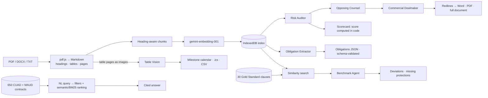

# ContractMind

**AI-native contract review.** Upload a raw contract PDF and ContractMind scores its risk against a playbook you control, writes redlines that explain themselves, extracts obligations and payment milestones as validated JSON and a calendar, benchmarks every clause against a Gold Standard library, and searches 650 real contracts in plain language. English and Bangla interface.

React + Vite + TypeScript on Vercel. Gemini is called through a server-side proxy (`api/gemini.ts`), so the API key never reaches the browser.

## What it does, mapped to the hackathon brief

| Brief | ContractMind | Where |
| --- | --- | --- |
| Ingest a raw contract PDF | pdf.js → Markdown with headings, tables and page numbers; scanned or large PDFs go to Gemini as page images sized for Vercel's 4.5 MB limit | Review |
| Risk scoring on **custom** playbooks | Gemini judges every playbook rule with a verbatim quote; the 0-100 score is calculated in code from rule weights; playbooks are created, edited and shared as JSON | Playbooks, Overview → scorecard |
| Structured JSON of obligations | Validated with `ajv` against a published JSON Schema (draft 2020-12) before download | Obligations → Structured JSON |
| Redlined version of the document | Word file with tracked changes and comments, redlined PDF, full document view | Redlines |
| Multi-agent system | Six agents; Risk Auditor → Opposing Counsel → Commercial Dealmaker hand off, Obligations, Table Vision and Benchmarks run in parallel | Analysing screen, Overview |
| RAG | Heading-aware chunks, `gemini-embedding-001`, IndexedDB; each agent reads only what it retrieves | Every analysis |
| Opposing counsel + counter-offers | Opposing Counsel lists one-sided clauses (indemnity first); the Dealmaker answers each, and each redline names the finding it answers | Redlines |
| Gold Standard RAG: deviations, missing protections | 30 gold clauses matched to contract sections by embedding similarity; missing required protections flagged in code, confirmed by the agent; GDPR clauses required for EU/UK contracts | Benchmarks |
| Vision agent → payment milestone calendar | Table pages read as images (nested phases kept), merged with text milestones, dates calculated, `.ics` and CSV export | Obligations → Milestones |
| Chain-of-thought for every redline | Other side's position, business risk, legal rationale and what to say; incomplete ones are completed or removed | Redlines |
| Natural-language search over a repository | 650 real contracts (CUAD v1 + MAUD); questions become filters, ranked by meaning + BM25, with a cited answer | Library |
| Data sources | CUAD v1 and MAUD (The Atticus Project, CC BY 4.0), which are SEC EDGAR filings; EDGAR fetch script ready | Library, samples |

The **How it works** page in the app shows the same table and the accuracy results.

## Architecture



All model calls go through `/api/gemini` (key server-side), and token usage is logged per call (`__contractmindTokens.totals()` in the console). To stay inside rate limits:

- **Model chain:** 3.8 Flash → 3.5 Flash → 3.5 Flash Lite. A model that keeps failing is skipped for 2 minutes (the last one never is).
- **503 (model overloaded):** retried on the same model with a short backoff (about 2 s, then 4 s) before moving to the next model.
- **429 (rate limit):** waits as long as Google asks (`Retry-After` / `RetryInfo`, up to 35 s) and retries; longer waits go straight to the backup model. A notice at the bottom of the screen shows the wait.
- At most 2 requests run at once; light tasks use the lite model (free-tier limits are per model); query embeddings are cached; the Library only asks the AI to read a question when the built-in parser finds no filter, and writes its summary only on request.

## Accuracy

`scripts/eval/cuad-eval.mjs` compares clause detection with CUAD's expert labels on 40 contracts (12 clause types), checks governing law, and checks that every evidence quote exists verbatim in the contract. Results go to `docs/eval/` and appear on the How it works page.

| Method | F1 (12 clause types) | Governing law | Quotes verbatim |
| --- | --- | --- | --- |
| Keyword baseline (no AI) | 70.7% | 66.7% | 100% |
| Gemini | run `GEMINI_API_KEY=... node scripts/eval/cuad-eval.mjs` | | |

## Saved demo runs

The three sample contracts come with a saved real analysis for each built-in playbook, in English and Bangla, in `public/demo/` (`<sample>.<playbook>.<lang>.json`). Analysing a sample replays the recorded agent pipeline with its real timings, shortened to about 6-14 seconds, and shows the result with a **Saved run** label, without calling the API. **Re-run**, a custom playbook or your own file always calls the AI.

To re-record (for example after switching models): set `GEMINI_API_KEY` in `.env`, run `pnpm dev`, analyse a sample, then run `await window.__cmSaveDemoRun()` in the browser console. That writes `public/demo/<sample>.<playbook>.<lang>.json` (dev server only).

## Demo and pitch

- [docs/DEMO.md](docs/DEMO.md): a 3-minute demo script.
- [docs/PITCH.md](docs/PITCH.md): problem, solution and comparison with Ironclad, Luminance, Spellbook, Kira and LawGeex.

## Setup

```bash
pnpm install
```

Create a `.env` file in the project root:

```
GEMINI_API_KEY=your-key-here
```

```bash
pnpm dev        # http://localhost:5173
pnpm test       # unit tests (RAG, scoring, playbooks, gold search, redlines, calendar, JSON schema, repository search)
pnpm build
```

On Vercel, set `GEMINI_API_KEY` in the project's environment variables (the `/api/gemini` function attaches it).

## Agent pipeline

Six Gemini agents work on each analysis (`runContractIntelligence` in `src/services/gemini.ts`):

```
Risk Auditor ──► Opposing Counsel ──► Commercial Dealmaker (redlines)
Obligation Extractor                         (in parallel)
Table page finder ──► Table Vision Agent     (in parallel, PDFs with tables)
Gold Standard search ──► Benchmark Agent     (in parallel)
```

- **Risk Auditor** scores every playbook rule. Its failed, partial and missing rules are handed to **Opposing Counsel**.
- **Opposing Counsel** reviews the contract as the other side's lawyer, indemnification first, and lists one-sided clauses (`OC-1`, `OC-2`, ...) with the other side's argument.
- **Commercial Dealmaker** answers each finding with a commercially workable counter-offer; every redline names the finding it answers.
- If an earlier agent fails, the next one still runs without the hand-off.
- The analysing screen shows the pipeline live, and the Overview tab shows each agent's model, time, tokens and how many contract sections it read.

## Payment tables and the milestone calendar

- **Table Vision agent** (`src/services/tableVision.ts`): pages that look like payment or milestone tables (markdown table rows, payment words, schedules, amounts, percentages) are rendered to images (up to 4 pages) and read by Gemini as images, so nested phases, merged cells and column order survive. Rows keep their phase and page.
- Table rows are merged with the milestones found in the text (same amount and similar name = same row), and each row shows whether it came from the text, the table image, or both. The agent is skipped, and shown as "Not needed", for DOCX/TXT, scanned PDFs (already read as images) and PDFs with no table pages.
- **Milestone calendar** (Obligations → Milestones): the effective date is taken from the contract and can be changed. A milestone gets a date from a stated date, from "N days after the effective date / previous milestone", or from trigger text such as "within thirty (30) days of the Effective Date" (business days, weeks and months too). Event-based triggers ("upon acceptance") are listed as "depends on an event".
- Timeline and month calendar views, colour-coded by party; **Add to calendar (.ics)** (all-day events with a 7-day reminder; calculated dates are marked as such) and **CSV** (UTF-8, opens in Excel) exports. Code: `src/utils/milestoneCalendar.ts`, `src/components/MilestoneCalendar.tsx`.

## Redlines and the obligations JSON

- **Every redline explains itself.** After the Dealmaker answers, any redline missing part of its chain-of-thought (other side's position, business risk, legal rationale, what to say) is sent back once to be completed; any still incomplete is removed. The Redlines tab says when this happened (`ensureRationales` in `src/services/gemini.ts`).
- **Full document view** (Redlines → Full document): the whole contract with each change in place, deletions struck through and insertions underlined (dotted while only proposed). Clicking a change shows its reasoning with Accept / Reject. Changes whose quote cannot be found, and new clauses, are listed below instead of being guessed (`src/utils/redlineDocument.ts`).
- **Redlined PDF**: the same document with numbered notes giving the reasoning for every change (print dialog → Save as PDF). The Word download with tracked changes is unchanged. The clean text export now uses the same tolerant placement, so accepted changes are applied even when the quote's spacing or quotes differ.
- **Obligations JSON** follows a published JSON Schema (draft 2020-12, `src/schema/obligations.v1.json`, downloadable from the JSON view). The export is validated with `ajv` before it is shown or downloaded; download is blocked with the errors listed if it does not match. It includes `schemaVersion`, ISO dates, the contract page of each obligation (found from the clause's position in PDFs) and, for milestones, the due date and how it was found.

## Contract repository (Library)

The Library searches **650 real contracts**: 498 from [CUAD v1](https://www.atticusprojectai.org/cuad) and 152 merger agreements from [MAUD](https://github.com/TheAtticusProject/maud), both by The Atticus Project under CC BY 4.0. (The previous Library showed 8 made-up entries and a "5,420 contracts" label; both are gone.)

- **Ask in plain words**, e.g. "contracts with liability caps below $1M under Delaware law". Gemini turns the question into filters (cap amount, uncapped liability, governing law, clause types, contract type, dataset, notice period, party); without the AI a rule-based parser does the same. Filters show as chips you can remove.
- **Ranking**: by meaning (embeddings) blended with keyword relevance (BM25) when the semantic index exists, by keywords otherwise; pure filter questions are sorted by the filtered value (e.g. smallest cap first).
- **Answer**: a short plain-language summary of the matches that cites contract ids (links scroll to the card).
- **Open in review** loads the full contract text (shipped gzip-compressed in `public/repository/texts/`).
- Metadata comes from the datasets' expert labels plus pattern matching. MAUD's own file list numbers deals differently from its text files, so merger titles and parties are read from each agreement's preamble (120 of 152 named; the rest are titled by MAUD number).
- Metadata comes from the datasets' expert labels plus pattern matching. CUAD's "Cap On Liability" label mostly marks clauses that exclude indirect damages; only 17 contracts state a dollar cap, and the Library says so rather than guessing.

**Building the data** (`scripts/repository/`, Node, no extra packages):

```bash
# 1. Catalogue + texts from the downloaded datasets (no API calls)
node scripts/repository/build-corpus.mjs --cuad <CUAD_v1 folder> --cuad-zip <CUAD_v1.zip> --maud <MAUD data folder>
# 2. Semantic index (needs your key once; writes public/repository/vectors.bin + vectors.json)
GEMINI_API_KEY=... node scripts/repository/embed-corpus.mjs
# 3. Optional, not yet run: add SEC EDGAR material contracts (needs your contact for the SEC and a key)
GEMINI_API_KEY=... node scripts/repository/fetch-edgar.mjs --user-agent "Your Name your@email" --count 4500
```

Until step 2 is run the Library shows "Keyword search (semantic index not built yet)".

**Jurisdiction**: the GDPR gold clauses (processing terms, international transfers) count as required only for contracts under EU/UK law or that mention the GDPR; for other contracts they are compared only when a similar section exists.

## Gold Standard RAG

- `src/data/goldStandards.ts` + `goldStandardsMore.ts`: 30 gold clauses, one per common CUAD v1 category (indemnity, liability cap, termination, confidentiality, governing law, assignment, change of control, non-compete, renewal, price changes, audit, warranties, SLA, insurance, GDPR processing and transfers, exit, and more). The wording is ContractMind's own balanced drafting of common market positions, labelled as such.
- `src/rag/goldIndex.ts` embeds the library once (cached in IndexedDB) and compares every gold clause with every contract section by cosine similarity.
- Gold clauses with a similar section (at least `VITE_RAG_GOLD_MIN_SIMILARITY`, default 0.6) are sent to the Benchmark Agent together with their closest sections, instead of the whole library.
- **Required** gold clauses with no similar section are flagged in code as possibly missing; the agent then confirms each as missing, present or not applicable. The Benchmarks tab lists confirmed missing protections with the gold wording to copy, and shows similarity, section and page for each comparison.
- Without an index (scanned PDF, RAG off) the agent falls back to the full library in the prompt.

## Custom playbooks and the risk report

- **Playbooks** page: duplicate a built-in playbook or start a new one, then edit its name, tolerances and rules (category, title, target standard, acceptable fallback, unacceptable terms, severity, weight). Changes save automatically in the browser (`localStorage`). Built-in playbooks stay read-only.
- **Import / Export JSON** shares a playbook between people (`*.playbook.json`). Imports are validated and cleaned (`src/utils/playbookStore.ts`), and never replace a built-in playbook.
- The scorecard shows a one-line explanation of the score, and every rule that is not passing gets an AI "what to do" suggestion.
- **Risk report (PDF)** on the results page opens the print dialog with the score, rules, evidence, suggested actions and redlines; choose *Save as PDF*.

## Chunking + retrieval (RAG) pipeline

Instead of sending the whole contract to Gemini for every task, the app indexes each document once and sends only the relevant passages.

**On upload (once per document)** — `src/rag/`
1. `pdfToMarkdown.ts` converts the PDF to Markdown with pdf.js: headings (font size, numbering, ALL-CAPS), lists, simple tables and page numbers. Pages with almost no text are flagged as scanned (OCR can be added later). DOCX/TXT are chunked as plain text.
2. `chunker.ts` splits at headings and records each chunk's heading path (`Chapter 2 > Payment Terms`) and start page. Sections longer than `VITE_RAG_CHUNK_SIZE` are split at paragraph, line, then sentence breaks, repeating the last `VITE_RAG_CHUNK_OVERLAP` characters at the start of the next piece. No text is dropped.
3. `embedder.ts` embeds `heading path + text` with `gemini-embedding-001` (`RETRIEVAL_DOCUMENT`), 100 chunks per request, retrying rate limits with exponential backoff.
4. `vectorStore.ts` stores chunks and vectors in the browser's IndexedDB, keyed by the SHA-256 of the file plus the embedding/chunking settings, so the same PDF is never processed twice.

**Per task or question**
- `retriever.ts` embeds the query (`RETRIEVAL_QUERY`) and returns the top-K chunks by cosine similarity, in document order. Each analysis agent searches with its own queries (playbook rules, gold-standard categories, obligation topics) and a K scaled from the base value.
- `promptBuilder.ts` labels every excerpt with chunk ID, heading and page, and tells Gemini to answer only from the excerpts, say "Not found in the document" otherwise, and cite chunk IDs (chat).
- Whole-document requests in chat ("summarize the entire contract") use `summarize.ts`: consecutive chunks are summarised in groups, then the summaries are combined.
- If indexing or retrieval fails (no API key, rate limit, scanned PDF), the app falls back to the previous behaviour of sending the whole document.

**Token logging** — every Gemini response's `usageMetadata` is logged to the browser console, and kept in memory:

```js
__contractmindTokens.table()    // per request
__contractmindTokens.totals()   // sums
__contractmindTokens.clear()
```

To compare before/after, analyse the same PDF once with `VITE_RAG_ENABLED=false` and once with `true` (restart `pnpm dev` after changing `.env`) and compare `totals()`. `src/rag/payload.test.ts` prints an offline estimate on a synthetic contract.

### Environment variables

All optional, read at build/dev start (client-visible, so they need the `VITE_` prefix; none are secrets).

| Variable | Default | Meaning |
| --- | --- | --- |
| `GEMINI_API_KEY` | – | Server-side key used by the proxy (required). |
| `VITE_GEMINI_MODEL` | `gemini-3.8-flash` | Main generation model. |
| `VITE_GEMINI_FALLBACK_MODEL` | `gemini-3.5-flash` | Backup used when the main model is busy, rate-limited or not responding. |
| `VITE_GEMINI_EMBEDDING_MODEL` | `gemini-embedding-001` | Embedding model. |
| `VITE_RAG_ENABLED` | `true` | `false` sends whole documents (old behaviour). |
| `VITE_RAG_TOP_K` | `5` | Base number of chunks per query. Agents use a multiple (risk and obligations ×3, redlines ×2.5, benchmarks ×2). |
| `VITE_RAG_CHUNK_SIZE` | `2000` | Max characters per chunk before a section is split. |
| `VITE_RAG_CHUNK_OVERLAP` | `200` | Characters repeated between split pieces. |
| `VITE_RAG_EMBEDDING_DIM` | `768` | Embedding vector size (128–3072). |
| `VITE_RAG_EMBED_BATCH` | `100` | Chunks per embedding request (max 100). |
| `VITE_RAG_SUMMARY_BATCH_CHARS` | `12000` | Characters per group in chunk-by-chunk summaries. |
| `VITE_RAG_MIN_PAGE_CHARS` | `40` | Pages with fewer characters are flagged as scanned. |
| `VITE_GEMINI_MAX_CONCURRENT` | `2` | Most Gemini requests running at once (protects the per-minute rate limit). |
| `VITE_GEMINI_LITE_MODEL` | `gemini-3.5-flash-lite` | Last resort when both Flash models fail, and first choice for light tasks (obligations, completing redline reasoning, Library questions). |
| `VITE_RAG_GOLD_MIN_SIMILARITY` | `0.6` | Similarity (0-1) at which a contract section counts as covering a Gold Standard clause. |

Changing the embedding model, dimension, chunk size or overlap re-indexes documents automatically (they are part of the cache key).

### Limits

- Scanned PDFs (no extractable text) are read by Gemini directly. Files up to about 2.4 MB are sent as they are; larger ones are rendered to page images with pdf.js and shrunk to fit Vercel's 4.5 MB request limit (up to 60 pages; if pages still do not fit, only the first ones are sent and the AI is told). OCR-based indexing is not implemented.
- Finished analyses are saved in the browser (IndexedDB) by document, playbook and language, so the same analysis opens instantly. **Re-run** always asks the AI again. Demo and incomplete results are not saved.
- The index lives in the user's browser (IndexedDB); clearing site data re-indexes on next use.
- The Gold Standard similarity threshold (0.6) has not yet been calibrated on real `gemini-embedding-001` vectors. Run one analysis with a key and check the Benchmarks tab: if clauses that are clearly in the contract are listed as possibly missing, lower `VITE_RAG_GOLD_MIN_SIMILARITY`; if almost nothing is checked for gaps, raise it. The agent's confirmation step limits the damage either way.
- Retrieval can miss a clause that does not resemble any query. Raise `VITE_RAG_TOP_K` if analyses report provisions as "Not Addressed" that exist in the document.
